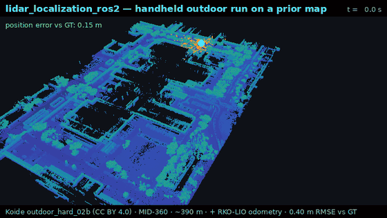
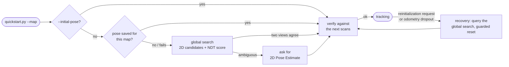
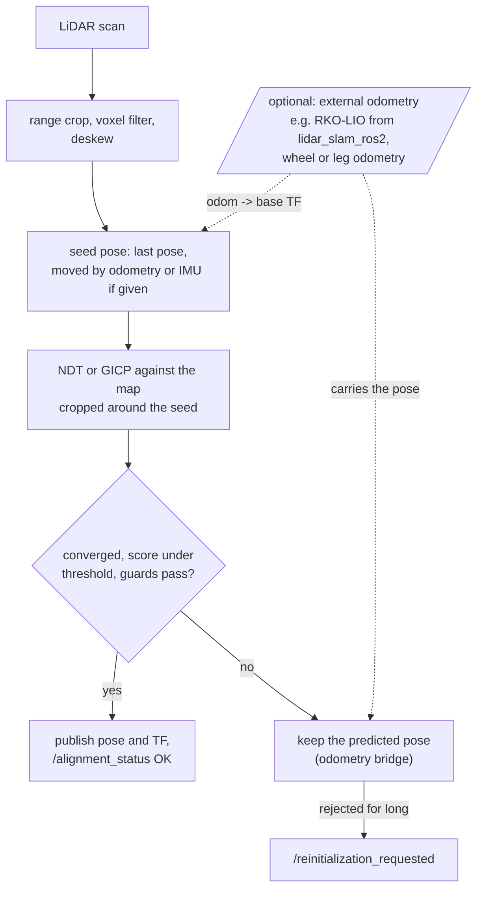

<div align="center">

<h1>lidar_localization_ros2</h1>

<p><strong>Map-based 3D LiDAR localization for ROS 2 and Nav2.</strong></p>

<p>
  <a href="https://github.com/rsasaki0109/lidar_localization_ros2/actions/workflows/main.yml">
    
  </a>
  
  
  
</p>



<p><em>Handheld Livox MID-360, ~390 m outdoors on a prior map, including stretches where the scans do not match the map and a section outside it. Each scan is matched to the map with NDT; RKO-LIO odometry predicts the motion between scans and carries the pose where matching fails. The error is 0.26 m RMSE for the whole run, in an offline replay started from the ground-truth pose (<a href="https://zenodo.org/records/10122133">Koide Hard Point Cloud Localization Dataset</a> <code>outdoor_hard_02b</code>, CC BY 4.0). <a href="./docs/readme-media.md">How this was made</a> · <a href="./docs/koide_gif_gallery.md">more runs</a></em></p>

</div>

Give it a point cloud map (`.pcd` or `.ply`) and a LiDAR stream; it publishes the
robot pose in the map. It finds the starting pose by itself, uses odometry and IMU when
you have them, and works standalone or as the localization source for Nav2.

## Where to start

| You want to | Go to |
| --- | --- |
| Localize your robot on a map you already have | [Install](#install), then [Quick start](#quick-start) |
| Run it on a Unitree Go2 or another MID-360 robot | [Go2 / MID-360 in five minutes](docs/go2_mid360_quickstart.md) |
| Navigate with Nav2 | [Nav2](#nav2) |
| Try it without a robot | [Run the public dataset](#try-it-without-a-robot) |
| See how accurate it is | [Benchmark](#benchmark) |
| Fix a bringup that does not work | [Troubleshooting](docs/troubleshooting.md) |

## Install

ROS 2 Jazzy is the main target; Humble is supported.

```bash
mkdir -p ~/lidarloc_ws/src
cd ~/lidarloc_ws/src
git clone https://github.com/rsasaki0109/lidar_localization_ros2.git
cd lidar_localization_ros2
scripts/bootstrap_colcon_workspace.sh --build
source ~/lidarloc_ws/install/setup.bash
```

This builds [ndt_omp_ros2](https://github.com/rsasaki0109/ndt_omp_ros2) and this
package, about 30 minutes on an 8-core machine.
[small_gicp](https://github.com/koide3/small_gicp) is optional. For a manual or
no-sudo build, see [local build](docs/local_build.md).

No ROS install? Build the [Docker image](docs/docker.md) and check it in one command:

```bash
docker build -f docker/Dockerfile -t lidar_localization_ros2 .
docker run --rm lidar_localization_ros2 /ws/src/lidar_localization_ros2/docker/smoke_status.sh
```

## Quick start

1. Start the LiDAR driver, and odometry if you have it.
2. Run quickstart with your map:

   ```bash
   ros2 run lidar_localization_ros2 quickstart.py --map /absolute/path/to/map.pcd
   ```

3. Check that it is tracking:

   ```bash
   ros2 run lidar_localization_ros2 check_lidar_localization_bringup.py --profile standalone
   ```

Quickstart finds the cloud and IMU topics, `/clock`, an `odom -> base` TF and the
LiDAR frame, and prints what it picked on its `Discovery:` line. Then it starts the
localizer and RViz. On the first run it searches the whole map for the robot; next time
it restores the pose saved for the same map. If the search finds no safe match, it asks
you for **2D Pose Estimate** in RViz (press **P**, click the robot, drag along its
heading) instead of guessing.

While it runs, the terminal prints one line whenever tracking starts, weakens, is lost
or comes back, with what to do about it, and RViz shows the same status above the
robot:

```text
[localization_status]: Tracking.
[localization_status]: Tracking lost: no scan has matched the map for 4 s. If it does not recover, set 2D Pose Estimate in RViz.
```

What each line means: [reading the status line](docs/troubleshooting.md#reading-the-status-line).

Useful options:

- `--dry-run` shows what it would start, without starting it.
- `--profile mid360` uses the Livox MID-360 preset.
- `--initial-pose X Y Z QX QY QZ QW` skips the search when you know the pose.
- `--no-rviz` for a headless robot; `--no-status` turns the status line off.
- `--help` lists the bringup options; `--help-all` adds the tuning ones.

**Map from [lidar_slam_ros2](https://github.com/rsasaki0109/lidar_slam_ros2) with a
MID-360?** Start its odometry first:

```bash
ros2 launch lidarslam rko_lio_odometry.launch.py
ros2 run lidar_localization_ros2 quickstart.py --map /path/to/output/my_map/map.pcd
```

More: [quickstart and automatic initialization](docs/quickstart.md),
[repeat-route site setup](docs/site_setup.md), [runtime details](docs/runtime.md).

## Nav2

```bash
ros2 launch lidar_localization_ros2 nav2_navigation.launch.py \
  map_yaml:=/absolute/path/to/map.yaml
```

Nav2 also needs a 2D occupancy map and an `odom -> base_link` source. In this mode the
localizer publishes `map -> odom`.

## Launch files

Quickstart covers most setups. To launch directly:

| Launch file | Use |
| --- | --- |
| `nav2_lidar_localization.launch.py` | Localization only |
| `nav2_navigation.launch.py` | Localization plus the Nav2 stack |
| `mid360_legged_localization.launch.py` | Livox MID-360 on a legged robot |
| `lidar_localization.launch.py` | Base launch with every argument exposed |

```bash
ros2 launch lidar_localization_ros2 mid360_legged_localization.launch.py \
  map_path:=/absolute/path/to/map.pcd \
  cloud_topic:=/livox/points imu_topic:=/livox/imu
```

## How it works

Startup finds a first pose; then every scan is matched against the map near the
predicted pose. When matching keeps failing, recovery searches the map again.



Each scan:



Map matching is always NDT (default) or GICP. External odometry is optional: it only
predicts the motion between scans and carries the pose where scans do not match the
map. It helps with fast or handheld motion; quickstart uses it when it sees an
`odom -> base` TF.

`/alignment_status` reports each step, and quickstart's status line turns it into
Tracking / Weak / Odometry only / Lost. Details: [global localization](docs/global_localization.md),
[initialization order](docs/quickstart.md#initialization-order),
[runtime](docs/runtime.md), [reading the status line](docs/troubleshooting.md#reading-the-status-line).

## Topics and frames

Default frames are `map`, `odom` and `base_link`.

| | Topics |
| --- | --- |
| Inputs | `/cloud`, `/initialpose` (in `map`), `/odom`, `/imu`, `/map_switch` |
| Outputs | `/pcl_pose`, `/path`, `/alignment_status`, `/reinitialization_requested` |
| Status (quickstart) | `/localization_status/status` (JSON), `/localization_status/marker` (RViz label) |

- Standalone mode publishes `map -> base_link`.
- Nav2 mode publishes `map -> odom` and needs an external `odom -> base_link`.
- `use_odom: true` reads `/odom`; it does not publish odometry TF.
- Each static LiDAR and IMU transform must have exactly one publisher.

All topic names can be changed. See the [frame contract](docs/frame_contract.md).

`/map_switch` (`std_msgs/String` holding a `.pcd` or `.ply` path) replaces the map at
runtime and keeps the current pose; a map that fails to load leaves the current one.

## Benchmark

Public datasets replayed through the same commands as above (odometry plus
`quickstart.py --map`). Each run starts with no initial pose, so the localizer has to
find the robot itself. Errors are measured in the map frame with no trajectory
alignment, so a wrong start shows up as error.

| Dataset | Runs | Started correctly | Median error | p95 error |
| --- | --- | --- | --- | --- |
| Koide outdoor, handheld MID-360 (4 sequences) | 12 | 12 | 0.08-0.12 m | 0.21-0.91 m |
| Koide outdoor kidnap (sensor carried elsewhere) | 6 | 6 | 0.04-0.12 m | 15.9-60.5 m |
| JEPLO, Unitree Go2, lidar_slam_ros2 map (4 sequences) | 12 | 12 | 0.03 m | 0.09-0.13 m |
| JEPLO, Go2 on wide maps, [low-sensor settings](docs/go2_mid360_quickstart.md#large-maps) (7 sequences) | 18 | 18 | 0.02-0.03 m | - |

Measured 2026-10-06 and 2026-10-11 on Jazzy at 1x. Ranges are over sequences.

What this does not cover:

- In the kidnap runs the error is large while the sensor is carried, until recovery.
- On wide Go2 maps, the default search can stay ambiguous and ask for a manual pose
  (Outdoor1). The low-sensor settings started every run in the table correctly; in six
  later replays, one Outdoor2 run stayed ambiguous and asked for a manual pose.
- No long multi-hour runs and no physical-hardware validation.

Per-sequence tables, how to rerun, and dataset links: [docs/benchmark.md](docs/benchmark.md).

## Try it without a robot

Build this package and `rko_lio` from
[lidar_slam_ros2](https://github.com/rsasaki0109/lidar_slam_ros2), then:

```bash
ros2 run lidar_localization_ros2 run_koide_public_bag.py --download
```

It downloads the Koide data, runs odometry and localization, and reports the error
against the ground truth. Playback takes about five minutes. Data is cached in
`./koide-data` and results go to `./koide-run-*`. See the
[public-bag guide](docs/koide-online-replay.md).

## Documentation

Using it:

- [Quickstart and automatic initialization](docs/quickstart.md)
- [Docker](docs/docker.md): build, smoke test, and running on your data
- [Go2 / MID-360 in five minutes](docs/go2_mid360_quickstart.md) and [MID-360 bringup](docs/mid360_legged_jetson.md)
- [Repeat-route site setup](docs/site_setup.md)
- [Runtime details](docs/runtime.md): parameter precedence, deskew, lifecycle
- [Frames](docs/frame_contract.md) and [troubleshooting](docs/troubleshooting.md)
- [Map alignment](docs/map_alignment.md): map frame and pose offsets

How it works:

- [Global localization](docs/global_localization.md)
- [IMU and deskew](docs/imu_estimation.md) and [pose covariance](docs/pose_covariance.md)

Results:

- [Benchmark](docs/benchmark.md) and [validated scope](docs/v1_status.md)
- [Koide demo gallery](docs/koide_gif_gallery.md)
- [Release notes](CHANGELOG.md)
- [Development notes](docs/dev/README.md): plans, roadmaps, experiment records

## License

BSD 2-Clause.
